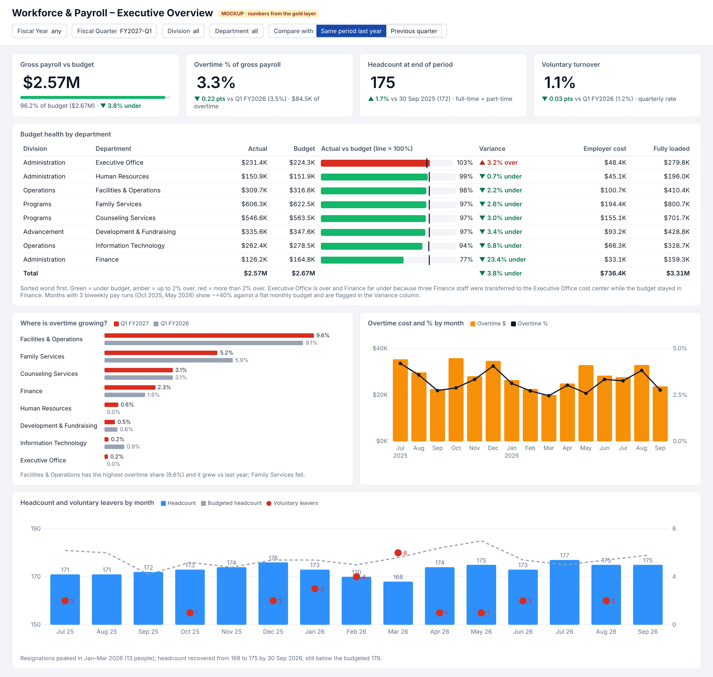
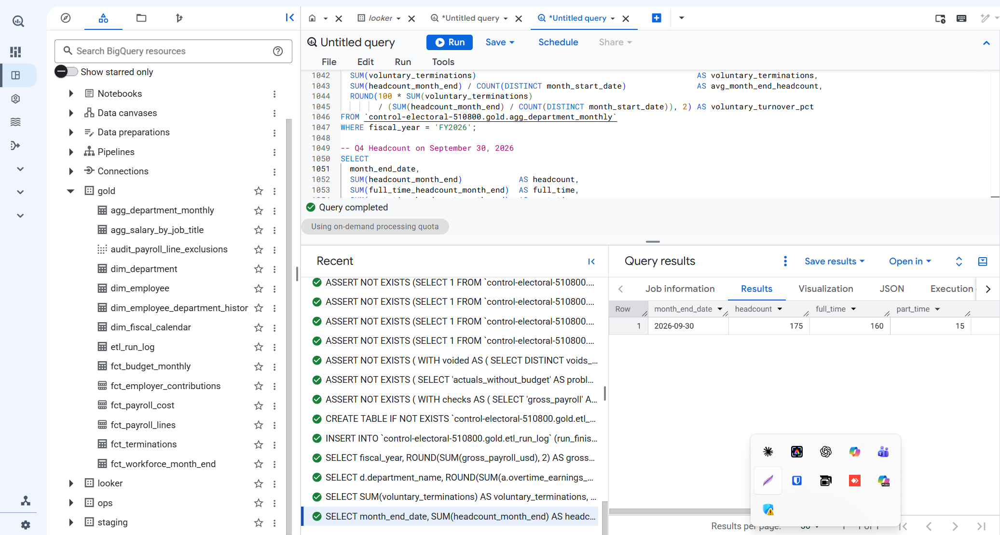

# Workforce & Payroll Analytics – Looker Technical Assessment

A production-style Looker layer for a leadership team that makes staffing and budget decisions from payroll data:

**bronze CSVs → Dataform gold layer (BigQuery) → LookML semantic layer → executive dashboard.**

| Question from the brief | Answer | Where it comes from |
|---|---|---|
| 1. Fully loaded payroll cost, FY2026 | **$14,006,416.09** (gross $10,878,262.41 + employer $3,128,153.68) | [Q1](#q1-fully-loaded-payroll-cost-in-fy2026) |
| 2. Highest overtime %, Q1 FY2027 | **Facilities & Operations, 9.58%** ($29,666.87 / $309,668.31) | [Q2](#q2-highest-overtime--in-q1-fy2027) |
| 3. Voluntary turnover rate, FY2026 | **12.75%** (22 voluntary leavers / 172.5 average month-end headcount) | [Q3](#q3-voluntary-turnover-rate-in-fy2026) |
| 4. Headcount on 30 Sep 2026 | **175** (160 full-time + 15 part-time) | [Q4](#q4-headcount-on-september-30-2026) |



---

## 1. Repository layout

```
workflow_settings.yaml              Dataform project settings (project, datasets, vars)
definitions/
  sources/                          declarations of the 5 raw (bronze) tables
  staging/                          typed + normalised views, every raw row kept
  gold/                             tables Looker reads (facts, dimensions, aggregates)
  assertions/                       custom data-quality assertions
  operations/etl_run_log.sqlx       last step of a run: feeds Looker's datagroup
lookml/
  workforce_payroll.model.lkml      connection, fiscal calendar, datagroup, explores, security
  views/                            one view per gold table
  dashboards/workforce_executive.dashboard.lookml
mockups/                            dashboard mockup (PNG + HTML) and the script that builds it
analysis/
  answers.sql                       SQL behind the four answers
  build_bigquery_script.py          compiles definitions/ into one BigQuery script
  bigquery_build.sql                generated: builds staging + gold and runs every assertion in BigQuery
  agg_department_monthly_export.csv export of gold.agg_department_monthly (feeds the mockup)
```

## 2. Architecture

```
raw_payroll (bronze, as-is)        staging (views)                 gold (tables)
  payroll_lines ───────────────▶ stg_payroll_lines ─────────────▶ fct_payroll_lines ─┐
  employer_contributions ──────▶ stg_employer_contributions ────▶ fct_employer_contributions
  employees ───────────────────▶ stg_employee_snapshots ───────▶ dim_employee_department_history (SCD2)
                                                                   dim_employee (current row)
  departments ─────────────────▶ stg_departments ──────────────▶ dim_department
  budget ──────────────────────▶ stg_budget ───────────────────▶ fct_budget_monthly
                                                                   dim_fiscal_calendar
                                                                   fct_payroll_cost  (lines ∪ contributions)
                                                                   fct_workforce_month_end, fct_terminations
                                                                   agg_department_monthly  ◀── dashboard
                                                                   agg_salary_by_job_title ◀── anonymised pay
                                                                   etl_run_log  ◀── Looker datagroup
```

Design principles:

- **Staging keeps everything; gold is curated.** Exclusions happen in one place and are listed row by row in `gold.audit_payroll_line_exclusions`, so Finance can reconcile raw totals with reported totals.
- **Every metric is computed at its own grain before it is combined.** Payroll (line grain), contributions (employee × run × type), headcount (employee × month end), terminations (employee) and budget (department × month) are each aggregated to department × month and only then joined. Nothing can fan out.
- **The dashboard reads a 120-row table.** All business logic lives in Dataform and LookML, never in dashboard tiles.

## 3. Data issues found and how each is handled

Raw payroll: 9,003 lines → 8,961 after de-duplication → **8,901 valid lines** in `fct_payroll_lines`.

| # | Issue | Evidence | Handling | Assertion that catches it tomorrow |
|---|---|---|---|---|
| 1 | **Duplicate ingestion** of payroll lines | 42 `payroll_line_id`s appear twice, same content, later `_ingested_at` (1–3 days later). $73,160.50 would be double counted | Keep the latest ingestion (`ROW_NUMBER() … ORDER BY ingested_at DESC = 1`) | `uniqueKey` on `fct_payroll_lines`; `assert_duplicate_lines_are_identical` fails if a re-sent line has *different* content (then "keep latest" becomes a business decision) |
| 2 | **VOID lines with positive amounts** | 26 lines with `line_status = VOID` and a `voids_line_id` pointing to an earlier POSTED line with the same amount. A plain SUM would count both ($47,944.81 twice) | Remove the VOID line **and** the line it cancels. The corrected amount, when there is one, arrives as a new POSTED line in the next pay run and is kept | `assert_void_lines_reference_posted_lines` (target missing, not POSTED, other employee, amount mismatch, POSTED line carrying a `voids_line_id`); `assert_gold_excludes_invalid_lines` |
| 3 | **Amounts stored as text with thousands separators** | `amount_usd` values like `"2,195.20"` in payroll lines | Strip commas, `SAFE_CAST` to NUMERIC | `assert_payroll_amounts_parse`: any value that is not NULL in raw but NULL after parsing (e.g. `"$2.195,20"`), and any amount ≤ 0 |
| 4 | **Test accounts in production data** | `TEST-001`, `TEST-002` (job title "Test Account") with 8 payroll lines ($12,000) and 18 contribution rows | Flagged in staging (`is_test_account`) and excluded from every gold table | `assert_no_unflagged_test_accounts`: any employee id not matching `^E[0-9]{4}$` that is not flagged; `assert_gold_excludes_invalid_lines` |
| 5 | **Several snapshots per employee** (department transfers) | 235 employee rows for 223 people; 12 employees have 2 snapshots with different `department_id`; payroll cost centers switch accordingly | `dim_employee` = latest snapshot; `dim_employee_department_history` = type-2 history (`valid_from`/`valid_to`) built from the snapshots | `uniqueKey` on both dims; `assert_employee_snapshots_consistent` (same load time twice, history gaps/overlaps, hire date changing between snapshots) |
| 6 | **NULL department** in employee snapshots | 4 employees (E1049, E1053, E1138, E1168) | Filled with the cost center most often charged on their payroll lines; `department_source = 'PAYROLL_FALLBACK'` for traceability | `nonNull` on `dim_employee_department_history.department_id`; `department_still_missing` check |
| 7 | **Upper-case e-mails** | 4 snapshots (e.g. `LUCIA.WHITE12@EXAMPLE.ORG`) | `LOWER(TRIM())` | cosmetic, normalised in staging |
| 8 | **Contributions whose payroll lines were all voided** | 19 contribution rows (employee/run pairs) have no valid line left | Kept (the employer paid them), charged to the cost center of the voided lines (`department_source = 'RUN_LINES'`) | `assert_gold_reconciles` (contributions kept = staging contributions) |

Things checked that were clean (and are now asserted so they stay clean): contribution keys are unique, every line has a known employee and department, every contribution has a pay run with lines, all codes are in the expected lists, no termination before hire, every salaried employee has exactly one of salary/hourly rate, the budget covers every department-month with actuals.

Reconciliation of the 102 excluded raw lines: 42 duplicate ingestions + 26 VOID lines + 26 cancelled lines + 8 test-account lines.

## 4. Assumptions

1. **Bronze columns are untrusted text.** Every staging column is cast through STRING, so the model works whether the CSVs were loaded with autodetect or as all-STRING.
2. **Effective date of a department transfer = snapshot load date.** The source has no effective date. Payroll confirms the switch happens in the first pay run after the load date. The first snapshot is valid from the hire date.
3. **Headcount department = home department on that day** (from the type-2 history). **Cost department = cost center on the payroll line**, as the brief defines. The two can differ.
4. **Employer cost of a pay run is reported in the month of the run's pay date and charged to the same cost center as the employee's lines in that run** (fallbacks above).
5. **Contractors** have no payroll lines and are excluded from headcount, as defined. They remain in `dim_employee` with `is_headcount_eligible = FALSE`.
6. **Voluntary turnover denominator** = average of the month-end headcounts of the months in the period (FY2026: 12 month ends). The rate is **not annualised**: a quarter shows a quarterly rate.
7. **Department-level turnover** uses the home department on the termination date. Rates above are company-wide.
8. **Access model**: the leadership team sees all departments (same as HR and Finance); only department managers are restricted.
9. **"Average salary by job title"** = annualised pay of *active full-time* employees: salary, or hourly rate × 2,080. Part-time pay cannot be annualised fairly.

### Concerns about the business definitions (implemented as written)

- **Gross payroll by month of pay date + biweekly payroll = artificial spikes.** October 2025 and May 2026 contain **3 pay runs** instead of 2, so they show +40% against a flat monthly budget (Oct: $1.25M vs $0.89M budget). Over a full fiscal year this evens out (FY2026: +1.2% vs budget), but monthly and quarterly comparisons are distorted. FY2026-Q4 contains one of those months, so "previous quarter" comparisons for Q1 FY2027 are misleading. That is why the dashboard defaults to **same period last year** and flags 3-run months. Recommendation: report by **pay period end date** (accrual) or pro-rate pay periods across months.
- **Budget was not moved with the transfers.** Three Finance employees (E1010, E1012, E1018) moved to the Executive Office cost center. Q1 FY2027: Finance is 23.4% under budget and the Executive Office 3.2% over. The money did not disappear; the budget sits in the wrong cost center. Finance should re-phase the budget.
- **Employer contributions are not recomputed on corrections.** FICA is 7.65% of gross for almost every employee/run, except where a line was voided and reissued: the original run keeps the FICA on the voided amount, and the reissue run does not include FICA on the corrected amount. The contribution table is the system of record, so I report it as is; the impact is small, but payroll should confirm.
- **Turnover uses a period average in the denominator, not annualised.** Fine for FY figures; for quarters it reads lower than people expect (1.1% per quarter ≈ 4.6% annualised). The tile says "not annualised".

## 5. LookML model

### Explores and join choices

| Explore | Base (grain) | Joins | Why it is safe |
|---|---|---|---|
| `agg_department_monthly` (dashboard) | department × month | `dim_department` many_to_one | One department per row; all SUMs exact. Metrics were aggregated at their own grain in Dataform first |
| `fct_payroll_cost` (detail) | one cost component (earning line **or** contribution row) | `dim_department`, `dim_employee` (safe fields), `employee_identity` (restricted), `fct_budget_monthly`, all many_to_one | Lines and contributions are **stacked** (UNION ALL), not joined. Joining them on employee + pay run would be many_to_many (several lines × three contribution types) and would also drop the 19 contributions without valid lines. Budget is joined many_to_one and de-duplicated by **symmetric aggregates** (it has a primary key) |
| `fct_workforce_month_end` | employee × month end | department, employee (no pay) | Headcount measure counts distinct employees on the last month end |
| `fct_terminations` | employee | department, employee | |
| `agg_salary_by_job_title` | job title | none | Already anonymised |

### Every business definition as a measure

| Definition | LookML measure |
|---|---|
| Fiscal year (Jul–Jun) | `fiscal_month_offset: -6` in the model (FY2026 Q1 starts July 2025) + `fiscal_year` / `fiscal_quarter` strings from `dim_fiscal_calendar` (`FY2026`, `FY2027-Q1`) for filters that read naturally |
| Gross payroll | `agg_department_monthly.gross_payroll`, `fct_payroll_cost.gross_payroll` |
| Employer cost | `employer_cost` (both explores) |
| Fully loaded payroll cost | `fully_loaded_cost` / `fct_payroll_cost.total_cost` |
| Overtime % | `overtime_pct` = `SAFE_DIVIDE(overtime_cost, gross_payroll)` |
| Headcount | `headcount`: **semi-additive**. It adds across departments but not across months, so it returns the headcount of the latest month in each result row (month, quarter, FY or no time dimension). Implemented with `ARRAY_AGG` + `UNNEST`, valid because the explore has no fan-out |
| Voluntary turnover rate | `voluntary_turnover_rate` = voluntary leavers / `average_headcount` |
| Budget variance % | `budget_variance_pct` = gross / budget − 1 |
| Department for cost | department on the payroll line (`fct_payroll_lines.department_id`) |

Labels and descriptions are written for executives, technical keys are hidden, and every main measure has a `drill_fields` set (department and month level, with `link`s to the detail explores).

### Liquid

1. **Conditional colour** on `budget_variance_pct` (green / amber / red), plus a flag *"includes N month(s) with 3 pay runs"* when that measure is in the query.
2. **Dynamic label and SQL**: the `comparison_period` parameter ("Same period last year" / "Previous quarter") switches both the label and the SQL of the `*_comparison` measures that feed the KPI tiles.
3. Liquid `sql_always_where` for row-level security (section 6).

### Custom visual element: inline budget bullet bar

`budget_bullet` renders, in each table row, a bar for actual spend with a black marker at 100% of budget and threshold colours. A native Looker bar chart cannot draw a per-row target marker with conditional colours, and the executive question ("who is over budget, by how much?") needs the ranking and the exact dollars together.

**Why it is worth the maintenance cost:** it is about 15 lines of HTML in a LookML measure. It is versioned and reviewed with the model, needs no JavaScript hosting, no custom-visualization deployment and no admin setup, and it degrades gracefully (the value is still printed). The cost is that it renders in table and single-value visualizations only, and colours live in code. If more such visuals were needed, I would move to a proper custom visualization.

### Prior-period comparisons

Dataform stores, on each department-month row, the same metric 3 and 12 months earlier. Summed over the months of a selection, they give the previous quarter or the same period last year, and they respect every filter. A comparison is returned only when **all** months of the selection have one, so a partial comparison never shows a wrong number. Looker's native `period_over_period` measures were considered. I chose explicit columns because they behave predictably with the string fiscal filters the business uses, and they are easy to reconcile in SQL.

## 6. Security

| Requirement | Implementation |
|---|---|
| Managers see only their department; HR & Finance see everything | User attribute `department_scope` (`ALL` or a department id; **default `NONE` = deny by default**). Every explore has a Liquid `sql_always_where` on its own department column. Unlike a user filter, it cannot be removed, and it also applies to drills, downloads, schedules and the API. The attribute should be synced from the IdP/HRIS (`departments.manager_employee_id` gives the mapping) |
| Salary and hourly rate per person only for HR & Finance | `access_grant: can_see_individual_pay` (user attribute `pay_data_access = yes`). `annual_salary_usd` and `hourly_rate_usd` have `required_access_grants`. In the payroll-cost explore the **whole identity join** (`employee_identity`: name, id, e-mail, **job title**) requires the grant, because job title + pay identifies one-person titles (Controller, CEO…). The restricted join uses raw column references so it never depends on a field the user cannot see |
| "Average salary by job title" for leadership | `gold.agg_salary_by_job_title`, computed in Dataform: active full-time staff, **suppressed when fewer than 5 people hold the title** (k-anonymity, `min_group_size` var), rounded to $1,000, median included. The table has **no department, location or date column**, so it cannot be narrowed by filters (the classic re-identification attack). No average-salary measure exists on `dim_employee` on purpose. Result: 12 titles published, 18 suppressed |

Residual risk I would raise: a department with very few people still reveals approximate pay through monthly totals (e.g. a one-person team). Next step: a minimum group size on the manager explores too.

## 7. Performance and cache refresh

- **Pre-aggregation in Dataform.** The dashboard reads `agg_department_monthly` (120 rows), so all 8 tiles are single-scan queries that return in well under a second.
- **Aggregate awareness** on the detail explore: `aggregate_table: monthly_cost_by_department_type` (month × fiscal quarter/year × division × department × cost type) answers most ad-hoc questions without touching the 25K-row fact.
- **Partitioning and clustering** of the facts by pay month and department/employee keeps detail queries cheap as history grows.
- **One datagroup tied to Dataform.** `etl_run_log` is the **last** action of the Dataform run: it depends on every gold table **and every assertion**, so it is only written when the data passed all checks. The datagroup `dataform_gold_refresh` runs `SELECT MAX(run_finished_at) FROM gold.etl_run_log` on the PDT maintenance schedule (every 5 minutes by default). When the value changes, Looker invalidates the cache and rebuilds the aggregate table. `max_cache_age: 24 hours` is a safety net. If a run fails an assertion, no new row is written and Looker keeps serving the last validated cache instead of half-built numbers. The model uses `persist_with: dataform_gold_refresh`.

## 8. Answers with SQL and Looker queries

All four answers come from the gold table that the dashboard uses (`analysis/answers.sql`).

### Q1. Fully loaded payroll cost in FY2026

**$14,006,416.09** = gross payroll $10,878,262.41 + employer cost $3,128,153.68.
(Summing the raw file naively, with duplicates, voids and test users, would overstate gross payroll by $141,388.)

```sql
SELECT ROUND(SUM(gross_payroll_usd), 2) AS gross, ROUND(SUM(employer_cost_usd), 2) AS employer,
       ROUND(SUM(gross_payroll_usd + employer_cost_usd), 2) AS fully_loaded
FROM gold.agg_department_monthly
WHERE fiscal_year = 'FY2026';
```
Looker: explore *Workforce & Payroll – Monthly Summary*, filter `Fiscal Year = FY2026`, measures `Gross Payroll`, `Employer Cost`, `Fully Loaded Payroll Cost`.

### Q2. Highest overtime % in Q1 FY2027

**Facilities & Operations: 9.58%** ($29,666.87 overtime / $309,668.31 gross). Next: Family Services 5.18%, Counseling Services 3.13%.

```sql
SELECT d.department_name, SUM(a.overtime_earnings_usd) / SUM(a.gross_payroll_usd) AS overtime_pct
FROM gold.agg_department_monthly a JOIN gold.dim_department d USING (department_id)
WHERE a.fiscal_quarter = 'FY2027-Q1'
GROUP BY 1 ORDER BY 2 DESC;
```
Looker: filter `Fiscal Quarter = FY2027-Q1`, dimension `Department`, measure `Overtime %`, sorted descending.

### Q3. Voluntary turnover rate in FY2026

**12.75%** = 22 voluntary leavers / 172.5 average month-end headcount (12 month ends, July 2025 – June 2026).

```sql
SELECT SUM(voluntary_terminations)
       / (SUM(headcount_month_end) / COUNT(DISTINCT month_start_date)) AS voluntary_turnover
FROM gold.agg_department_monthly
WHERE fiscal_year = 'FY2026';
```
Looker: filter `Fiscal Year = FY2026`, measure `Voluntary Turnover Rate` (with `Voluntary Leavers` and `Average Month-end Headcount` to show the parts).

### Q4. Headcount on September 30, 2026

**175** (160 full-time + 15 part-time; contractors excluded).

```sql
SELECT SUM(headcount_month_end) AS headcount
FROM gold.agg_department_monthly
WHERE month_end_date = DATE '2026-09-30';
```
Looker: filter `Payroll Month = 2026-09`, measure `Headcount (end of period)`. The same measure also returns 175 with `Fiscal Quarter = FY2027-Q1` and no time dimension, because it takes the last month end of the selection.

## 9. How the work was validated

The raw CSVs were loaded as-is into BigQuery (project `control-electoral-510800`, dataset `looker`). `analysis/build_bigquery_script.py` compiles the Dataform project into one BigQuery script, `analysis/bigquery_build.sql`. The script does what `dataform run` does, in dependency order: it creates the `staging` and `gold` datasets, builds every view and table with its partitioning and clustering, runs **every assertion as a BigQuery `ASSERT` statement** (the 10 custom assertions plus every `uniqueKey` / `nonNull` / `rowConditions` check declared in the configs; 69 checks in total, and the script stops at the first failure), writes the `etl_run_log` row and returns the four answers. All checks pass. The four answers were also cross-checked with an independent pandas calculation on the CSVs.

```bash
python3 analysis/build_bigquery_script.py --project <gcp project> --raw-dataset <dataset with the 5 raw tables>
# then paste analysis/bigquery_build.sql into the BigQuery console and run it
python3 mockups/build_mockup.py <folder with departments.csv>   # mockup from the gold export
```

With Dataform itself, the same project runs with `dataform run` (or from the Dataform UI in BigQuery). The script exists so a reviewer can reproduce everything with one paste.

LookML was written against the Looker reference but not validated in a live Looker instance (none was provided). The items I would check first in the LookML validator: the `ARRAY_AGG`/`UNNEST` headcount measure, the Liquid field labels driven by `comparison_period`, and the fiscal timeframes in the aggregate table.



## 10. What I would do next with more time

1. Connect a Looker instance to the BigQuery gold layer, run the LookML validator and Content Validator, and replace the mockup with real screenshots.
2. Agree an accrual view of payroll (by pay period, pro-rated across months) with Finance to remove the 3-pay-run spikes. Then re-phase the budget for the transferred employees.
3. Move the department scope from a manually set user attribute to an IdP/HRIS-synced attribute, and add a minimum group size on the manager-facing explores.
4. Add Dataform unit tests (`type: "test"`) with small fixtures for the void, de-duplication and SCD2 logic, and run Dataform + LookML CI (Spectacles or Looker CI) on every pull request.
5. Add `incremental` builds to the facts (`ingested_at` watermark) once volume justifies it.
6. Annualised turnover and a regrettable vs non-regrettable split, once HR provides the field.

## 11. Use of AI tools

An AI assistant (Claude) was used extensively throughout this assessment: profiling the CSVs and spotting candidate data issues, drafting the Dataform SQL, the assertions and the LookML, writing the script that compiles the project for BigQuery and the mockup script, and drafting this README.

I reviewed every file and validated the data issues and the four answers against an independent calculation.
